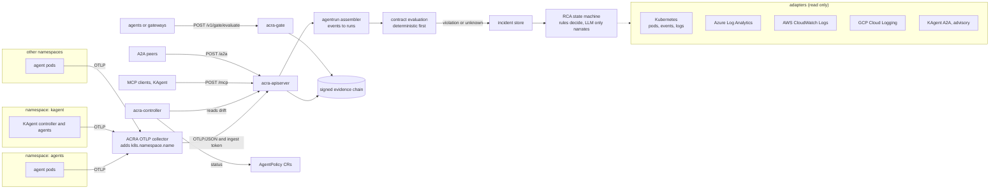

<div align="center">

# ACRA — Agentic Control & Runtime Assurance

**Proof that your AI agents stayed inside the lines — on Kubernetes, continuously.**


</div>

> *Every call returned 200. Every agent passed its own check. The approval at the end was one nobody authorized.*

That's **combinative drift** — correct components composing into an outcome no one approved. Single-layer checks miss it. ACRA is the layer that reads the *composition*, holds it at the gate, and hands you a signed evidence chain an auditor can actually read.


*Everything green → inject a drift → the gate HOLDs it, a ticket opens, and the evidence shows `independence = 1, required 2`. Nothing faked — that's the real gate running.*

---

## Why this exists

Regulators ask one question: **"Can you prove this did what you said?"** For normal software, CI/CD is the proof. AI agents break it — same image, same manifest, *different answer*; GitOps shows zero changes while behavior drifts. And there's no settled rule for AI agents yet, so the proof has to come from **your own controls, continuously.**

ACRA is a deterministic control plane beside your agents. Agents **propose**; the gate **admits or holds** every consequential write; every decision emits a **signed, queryable proof**.

## See it in 60 seconds

**No cluster — just Go:**
```bash
make run                       # console at http://localhost:8080
make inject KIND=combinative   # watch the gate HOLD it
```

**On Kubernetes (kind):**
```bash
make up                        # cluster + image + CRD + operator + OTel + deploy
open http://localhost:8080
make inject KIND=independence  # or: epoch · authority · schema · … (12 kinds)
kubectl get agentpolicy        # the operator reports drift on the cluster itself
```

<div align="center">


</div>

## How it works — 4 Kubernetes-native patterns

1. **Behavioral-baseline gate** — Kyverno admission enforces the approved set; the gate computes drift & evidence independence and holds what's outside it.
2. **Continuous proof via OpenTelemetry** — every gate decision emits a span with operational IDs + `acra.*` proof attributes.
3. **CRD controller → re-approval** — a `controller-runtime` operator watches `AgentPolicy` and reports/drives drift.
4. **Automated evidence** — cluster telemetry becomes an auditor-queryable, signed chain, not a spreadsheet.

## Architecture



ACRA is a control plane beside the agents. It observes, evaluates, opens incidents and explains them. It does not restart pods, change configuration or call write APIs on any cloud or cluster. The only thing that can block an agent action is the gate, and only for callers that choose to call it.

| Component | Runs as | Job |
|---|---|---|
| `acra-apiserver` | Deployment, 1 replica | `/v1` API, console, ingest, contract registry, evaluation, incidents, RCA, tool gateway, MCP and A2A servers, signed evidence store |
| `acra-gate` | Deployment | `POST /v1/gate/evaluate`: runs the detectors against a proposed write and returns `ADMIT` or `HOLD` |
| `acra-controller` | Deployment | Watches `AgentPolicy` objects in all namespaces and writes live drift status onto them |
| OTLP collector | Deployment | Receives OTLP from agents in any namespace, adds namespace and pod labels, forwards OTLP/JSON to the apiserver |

The gate decision flow for one consequential write:

1. An agent **proposes** a consequential action and calls the gate.
2. The gate checks the **approved tuple** (prompt, manifest, ruleset, formula). Kyverno enforces the approved set on pods.
3. It computes **drift** and **evidence independence** (root sources, not citations).
4. **ADMIT** if inside the baseline and independence is satisfied, otherwise **HOLD**.
5. The decision is emitted as an OTel span and a signed evidence event.
6. The controller reflects drift on the `AgentPolicy` status. Nothing closes without a passing re-run of the detector that opened it.

Key decisions: the gate is deterministic code (an LLM never admits or holds). Evidence is append-only and ed25519 signed. Independence counts roots, not citations. Epochs are fences: work published under a stale epoch is held.

## "Isn't this just Kyverno + OpenTelemetry?"

Fair question — and the answer is the whole point. Each of those secures *a layer*: Kyverno admits pods, OTel correlates traces, OPA evaluates policy, SPIFFE proves identity. **None of them, alone, can tell you whether correct components composed into an *authorized* outcome.** A green admission check is not business truth; a successful trace is not an authoritative receipt. ACRA layers *on top of* them — reusing Kyverno, OTel and SPIFFE — and adds the gate + signed evidence that read the whole chain. → [How ACRA relates to the ecosystem](docs/08-landscape.md)

## What's inside

**Drift control (v0.1, unchanged)**

- **Gate + 12 detectors** — combinative drift, evidence independence (roots, not citations), epoch fencing, authority-at-now, and 8 more — all unit-tested. Also served over HTTP by `acra-gate`.
- **Signed evidence chain** — append-only, ed25519, hash-chained, with a tail anchor so truncation is detected.
- **Operator** — `kubectl get agentpolicy` shows live `Phase` / open tickets; it reports `Unknown` (not green) when the apiserver is unreachable.
- **OpenTelemetry** → collector. **Kyverno** admission policy. **Live console.**
- **Grounded in a taxonomy** — the 12 detectors are a principled subset of **72 drift checks across 12 domains** ([drift taxonomy](docs/07-drift-taxonomy.md)).

**Agent reliability pipeline (v0.2)**

- **OTLP ingest from any namespace** → normalized events → one *run* per agent execution.
- **Agent contracts** — versioned, machine-checkable: output schema, forbidden patterns, tool allowlist and call/retry limits, latency, token and context budgets, optional LLM rubrics. Deterministic checks run first; missing telemetry is `unknown`, never a pass.
- **Incidents** — violations are deduplicated into incidents with a signed audit trail.
- **Root-cause analysis** — a bounded state machine. Rules produce ranked hypotheses and confidence; an optional LLM only writes the narrative and must cite real evidence. Recommended actions are advice, never executed.
- **Read-only evidence adapters** — Kubernetes (pods, events, logs; namespace allowlist), Azure Log Analytics, AWS CloudWatch Logs (in-process SigV4, IRSA), GCP Cloud Logging, KAgent (advisory only). A failed source is reported as unavailable, never as "clean".
- **Access control and safety** — reader / ingest / admin roles, redaction, query-injection defence on every cloud query, https-only endpoints, a read-only tool gateway with an audit trail.
- **MCP and A2A servers** — `POST /mcp` exposes the read-only tools to MCP clients, and `POST /a2a` plus the Agent Card (`/.well-known/agent-card.json`) lets peer agents list and investigate incidents. Both are on by default under Helm and sit behind the same bearer tokens.
- **Memory rules in contracts** — cap and inspect an agent's calls to the memory tools you name (write/read counts, write size, forbidden content).
- **Optional Valkey** — shares the gate's epoch fence across restarts and replicas (`valkey.enabled`). It holds only epochs.
- **Helm chart** — apiserver, gate, operator, OTLP collector, RBAC, PVC, secrets, optional NetworkPolicy: [`deploy/helm/acra`](deploy/helm/acra).

## Run it in your cluster

```bash
helm upgrade --install acra deploy/helm/acra -n acra-system --create-namespace \
  --set image.repository=ghcr.io/deepnavakoti/acra --set image.tag=0.2.0 \
  --set 'adapters.kubernetes.namespaces={agents,kagent}'

# admin token, then the console
kubectl -n acra-system get secret acra-auth -o jsonpath='{.data.api-token}' | base64 -d
kubectl -n acra-system port-forward svc/acra-apiserver 8080:80
```

Then point agents in **any namespace** at the collector
(`OTEL_EXPORTER_OTLP_ENDPOINT=http://acra-collector.acra-system.svc:4317`),
register a contract per agent, and enable the cloud adapters you use:

```yaml
# values.yaml (excerpt)
adapters:
  kubernetes: { enabled: true, namespaces: [agents, kagent, payments] }
  azure:      { enabled: true, workspaceId: <log-analytics-guid> }
  aws:        { enabled: true, region: us-east-1, logGroups: [/eks/agents/app] }
  gcp:        { enabled: true, project: my-project }
  kagent:     { enabled: true, url: https://kagent.kagent.svc }   # advisory only
serviceAccount:
  annotations: {}   # IRSA / Azure workload identity / GKE Workload Identity
```

**Everything below this line, up to "Status and honest limits", is the operations guide: how ACRA covers every namespace, what it reads, the identities and permissions it needs, and how one run flows through it.**

## Coverage across namespaces and agents

Coverage has three independent parts. Missing any one degrades the result, and ACRA reports the gap instead of hiding it.

### 1. Telemetry in: any namespace, no per-namespace install

Agents send OTLP to the collector Service (`http://acra-collector.acra-system.svc:4317` gRPC or `:4318` HTTP). Pods in any namespace can reach a ClusterIP Service, so nothing is deployed per namespace. The collector's `k8sattributes` processor stamps `k8s.namespace.name`, `k8s.pod.name`, `k8s.deployment.name` and `k8s.node.name`, so agents do not have to set the namespace themselves.

Each agent span should carry:

| Attribute | Used for |
|---|---|
| `acra.agent.id` (or `gen_ai.agent.id`, else `service.name`) | which agent and which contract |
| `acra.contract.version` | which contract version the run claims |
| `acra.kind` | `agent.request`, `agent.response`, `tool.call`, `model.call`, `error`, `infra`, `log` |
| `gen_ai.request.model`, `gen_ai.usage.input_tokens` / `output_tokens` | model calls and provider-reported token usage |
| `gen_ai.tool.call.id`, `acra.attempt` | tool calls and retry counting |
| `http.response.status_code` | upstream status |
| `acra.tenant.id`, `session.id`, `acra.agent.run.id` | grouping |

If `acra.kind` is absent, a span with `gen_ai.request.model` is treated as a model call. Events that fail validation (missing agent id or trace id, oversized payloads, span floods) are rejected and the ingest response lists the reasons. To restrict who can reach the collector, enable `networkPolicy` in the chart and list the namespace labels allowed to send. Only OTLP/JSON reaches the apiserver (`POST /v1/traces`); the bundled collector converts for you.

### 2. Contracts: what "correct" means for each agent

Telemetry says what happened, not what should have happened. Each agent needs a contract registered by an admin:

```json
{
  "id": "support-v1", "agentId": "support", "version": "1",
  "outputSchema": {"type": "object", "required": ["answer"]},
  "forbiddenPatterns": ["(?i)api[_-]?key"],
  "tools": {"allowed": ["search", "ticket.create", "memory.save", "memory.search"], "maxCalls": 20, "maxRetries": 3},
  "memory": {
    "writeTools": ["memory.save"], "readTools": ["memory.search"],
    "maxWrites": 5, "maxReads": 20, "maxWriteBytes": 4096,
    "forbiddenWritePatterns": ["AKIA[0-9A-Z]{16}"]
  },
  "limits": {"maxLatencyMs": 30000, "maxTotalTokens": 50000, "maxContextUtilization": 0.9}
}
```

```bash
curl -H "Authorization: Bearer $TOKEN" -X PUT $ACRA/v1/contracts -d @contract.json
```

- Unknown fields are rejected, so a misspelt limit fails loudly instead of silently never firing.
- A run with no matching contract is not evaluated and opens no incident. It is counted in `GET /v1/pipeline/stats` so the gap is visible, and never recorded as a pass.
- **Memory rules** check the tool calls an agent makes to the memory tools you name (ACRA cannot see inside the store). A tool not listed is not treated as memory. Violations are `memory.maxWrites`, `memory.maxReads`, `memory.writeBytes` and `memory.forbiddenWrite[i]`; matched text is never echoed. If a write's input was not captured the result is `unknown`, never a pass. A contract is rejected if a memory rule has no matching tool list, a tool is both read and write, a limit is negative or a regex is invalid.

### 3. Cluster and cloud evidence: scoped, allowlisted, read-only

When a run violates its contract, the RCA step asks the adapters for evidence around the run's time window, keyed on the trace id, agent id, service name and namespace. The Kubernetes adapter reads only namespaces listed in `adapters.kubernetes.namespaces` and selects pods by the label `app=<service.name>`; any other namespace is reported as an unavailable source.

## What ACRA reads from each system

All adapters are read-only and optional. Each returns normalized signals plus a `partial` flag. A failed or truncated source is listed in the report as unavailable or partial, never treated as "no problems".

| Source | How it is queried | Correlation keys it expects | Identity |
|---|---|---|---|
| Kubernetes | client-go: list pods and events, read pod logs, only in allowlisted namespaces | pod label `app=<service.name>`; namespace from the run | in-cluster ServiceAccount, Role or ClusterRole from the chart |
| Azure | Log Analytics REST, KQL over `AppTraces`, `AppExceptions`, `AppDependencies` | `OperationId == traceId`, `Properties["agent_id"]`, `AppRoleName == service` | managed identity or workload identity (recommended), or a service principal |
| AWS | CloudWatch Logs `FilterLogEvents`, SigV4 signed in-process, no AWS SDK | trace id or agent id in the log message | IRSA web identity, or environment credentials |
| GCP | Cloud Logging `entries:list` | `trace`, `jsonPayload.trace_id`, `jsonPayload.agent_id`, `resource.labels.service_name` | GKE Workload Identity via the metadata server |
| KAgent | A2A JSON-RPC to the KAgent endpoint | agent id | optional bearer token |

KAgent output is advisory: it is shown as a hypothesis from another agent and never changes ACRA's confidence or verdict. Identifiers are validated against a strict pattern before being placed into KQL, CloudWatch or Cloud Logging queries, because they originate from telemetry an agent controls.

**Minimum permissions**

| Cloud | Grant | Do not grant |
|---|---|---|
| Kubernetes | `get,list` on `pods`, `events`; `get` on `pods/log` (the chart creates this) | secrets, configmaps, exec, any write verb |
| Azure | `Log Analytics Reader` on the workspace | contributor or owner |
| AWS | `logs:FilterLogEvents` on the listed log groups | `logs:*`, anything outside logs |
| GCP | `roles/logging.viewer` (or `logging.privateLogViewer` for private logs) | editor or owner |

**Identity setup** — annotate the chart's ServiceAccount:

```yaml
# EKS (IRSA)
serviceAccount:
  annotations: { eks.amazonaws.com/role-arn: arn:aws:iam::111122223333:role/acra-logs-reader }
adapters:
  aws: { enabled: true, region: us-east-1, logGroups: [/eks/agents/app] }

# AKS (workload identity)
serviceAccount:
  annotations: { azure.workload.identity/client-id: 00000000-0000-0000-0000-000000000000 }
  podLabels:   { azure.workload.identity/use: "true" }
adapters:
  azure: { enabled: true, workspaceId: <log-analytics-workspace-guid> }

# GKE (workload identity)
serviceAccount:
  annotations: { iam.gke.io/gcp-service-account: acra@PROJECT.iam.gserviceaccount.com }
adapters:
  gcp: { enabled: true, project: PROJECT }
```

Cloud endpoints must be `https` (plain `http` only for loopback, in tests). On AKS, the Azure workload identity federated token flow has not been exercised; a service principal secret works but is the weaker choice.

## What happens to one agent run

1. **Ingest.** OTLP spans become normalized events. Payloads and attributes are size-limited and redacted before storage (tokens, keys, common PII patterns).
2. **Assemble.** Events are grouped into a run per trace and agent. Duplicates are dropped, memory is bounded, and idle runs are swept so a never-finished run still gets evaluated.
3. **Evaluate.** The run is checked against its contract. Deterministic checks (schema, forbidden patterns, tool allowlist and counts, memory rules, retries, latency, tokens, context use) run first. Rubric checks are scored by an LLM judge only when one is configured, and a judge can never override a deterministic failure. Missing telemetry yields `unknown`, never a pass.
4. **Incident.** A violation or `unknown` opens an incident, deduplicated by a fingerprint of the agent and the violated rules.
5. **Investigate** (`POST /v1/incidents/{id}/investigate`, or `ACRA_AUTO_INVESTIGATE=1`). A bounded state machine collects adapter evidence, classifies it and ranks hypotheses by rule: `rate_limit`, `context_overflow`, `tool_loop`, `tool_failure`, `timeout`, `resource_exhaustion`, `crash_loop`, `schema_violation`, `safety_violation`, `cost_overrun`, `missing_telemetry`, `unknown`. An optional LLM writes the narrative; any reference it cites must exist in the evidence or the narrative is discarded.
6. **Report.** Hypotheses with cited evidence, what ACRA could not determine, and unavailable or partial sources. Recommended actions are advice; ACRA never executes them.
7. **Evidence.** Decisions are appended to the signed, hash-chained store.

Token usage comes only from provider-reported usage. A `429` alone is not treated as a billed call.

## The gate

The gate is separate from observation. An agent (or a gateway in front of it) calls it before a consequential write:

```bash
curl -H "Authorization: Bearer $INGEST_TOKEN" $GATE/v1/gate/evaluate -d '{
  "task":"refund-123","epoch":4,
  "tuple":{"prompt":"p1","manifest":"m1","ruleset":"r1","formula":"f1"},
  "claims":["customer verified"],
  "lineage":{"nodes":[{"id":"a","kind":"root","provider":"crm"},{"id":"b","kind":"root","provider":"kyc"}],"edges":[]},
  "promotesStatus":true,"subject":"refund-123","newStatus":"approved","signals":{}
}'
```

- The policy (approved tuples, invariants, independence threshold) is loaded from a server-side file mounted from a ConfigMap. Callers cannot supply or change it. No policy file or an empty approved set means the gate refuses to start (fail closed).
- Each task has an epoch. A write carrying an older epoch is held. An admin sets the current epoch with `PUT /v1/gate/epochs/{task}`.
- Claims with no lineage graph are held. The gate returns `ADMIT` or `HOLD`; it checks, it does not decide business outcomes, and it blocks only callers that ask it.
- Kyverno remains the admission layer for pods, optionally with `config/kyverno/approved-set.yaml`.

**Where the epoch fence is stored**

| Mode | Helm | Behaviour |
|---|---|---|
| Memory (default) | `valkey.enabled=false` | Epochs live in the gate process and reset on restart. Run one gate replica. |
| Valkey | `valkey.enabled=true`, `valkey.url=rediss://...` | Epochs are compared and raised atomically (Lua script) and shared by several gate replicas, surviving restarts. |

```yaml
valkey:
  enabled: true
  url: rediss://valkey.data.svc:6379
  username: acra            # optional
  passwordKey: valkey-password
auth:
  existingSecret: acra-auth # must contain the key named by passwordKey
```

ACRA does not install Valkey; run your own with TLS and a password. The chart refuses to render if `valkey.enabled` has no `url`, or `passwordKey` is set without `auth.existingSecret`. Fail closed: if Valkey is unreachable at request time the gate answers 503/HOLD, and a configured but unreachable Valkey stops the gate at startup. Valkey holds only epoch numbers; the evidence chain stays in bbolt. Do not run several gate replicas on `gate.persistence`.

## Access control, MCP and A2A

Auth is opt-in so the demo works unauthenticated; under Helm it is on by default with generated secrets.

| Role | Can |
|---|---|
| `reader` | read snapshots, tickets, incidents, evaluations, contracts, evidence, tools |
| `ingest` | send events and OTLP, call the gate |
| `admin` | everything, including contracts, investigate, resolve, set epochs |

- `ACRA_API_TOKEN` is one admin token (16+ characters). `ACRA_API_TOKENS` is `token:principal:role|role,...` for more principals.
- The chart creates a separate `ingest` token for the collector so it cannot read or administer anything.
- The tool gateway exposes only read tools, validates arguments and audits every call into the evidence chain.
- `POST /v1/demo/inject` exists only with `apiserver.demo=true` (off by default).

**ACRA as an MCP server and an A2A server** — other agents and KAgent can call the apiserver on the same port and tokens:

| Endpoint | Protocol | Role needed | Content |
|---|---|---|---|
| `POST /mcp` | MCP, Streamable HTTP, JSON responses | `reader` | The read-only tools from `GET /v1/tools`: `initialize`, `ping`, `tools/list`, `tools/call`. Every call is audited. |
| `GET /.well-known/agent-card.json` (also `/agent.json`) | A2A Agent Card | none | Public. Lists skills and the A2A URL. |
| `POST /a2a` | A2A 0.3 JSON-RPC, synchronous | `reader` | Skills `list-incidents`, `get-incident`, and `investigate-incident` (needs `admin`). |

```yaml
apiserver:
  mcp:  { enabled: true }
  a2a:  { enabled: true }
  publicUrl: ""           # URL peers use (Ingress/Gateway); empty = in-cluster service URL
  allowedOrigins: []      # browser origins only; agents send no Origin header
```

In-cluster, for a release named `acra` in `acra-system`: MCP is `http://acra-apiserver.acra-system.svc:80/mcp` and the Agent Card is `http://acra-apiserver.acra-system.svc:80/.well-known/agent-card.json`. Give each calling agent its own `reader` token (`token:principal:reader`) and grant `admin` only where investigation is wanted. There is no Ingress, so nothing is exposed outside the cluster unless you add one; if you do, set `publicUrl`. For KAgent, register the MCP URL as a remote MCP server with the bearer token from a Secret; the exact KAgent resource schema has not been checked here.

## Evidence and storage

- Evidence is an append-only hash chain signed with ed25519. A separate anchor records the tail, so truncating the end of the chain is detected as well as editing the middle.
- The signing key comes from the Secret (`signing-key`, 64 hex characters). Lose it and old evidence will not verify, so the chart keeps the generated Secret and the PVC on uninstall.
- Stores are bbolt files on one PVC (`/data/evidence.db`, `/data/incidents.db`). bbolt is single-writer, so the apiserver runs one replica with a `Recreate` strategy.
- Auditors query `GET /v1/evidence/{id}` and `GET /v1/incidents/{id}/evidence`.

## Deploying

Resource names are `<release>-apiserver`, `<release>-collector`, `<release>-gate` and `<release>-auth` (prefixed with the release name, or `<release>-acra` when the release name does not contain "acra"). The commands above assume a release called `acra`. Then:

1. Point agents at the collector: `OTEL_EXPORTER_OTLP_ENDPOINT=http://acra-collector.acra-system.svc:4317`.
2. Register a contract per agent.
3. Create `AgentPolicy` objects per namespace as needed (`config/samples/agentpolicy.yaml`).
4. Set `gate.policy.approvedTuples` to your real approved set. The default is a placeholder.
5. Enable the cloud adapters you use.

Chart notes:

- `adapters.kubernetes.clusterWide=false` (default) creates a namespaced `Role` and `RoleBinding` in each listed namespace, so they must exist at install time. `true` creates one `ClusterRole` and binding.
- The CRD ships in `crds/`. Helm installs it on first install and never upgrades or deletes it; apply `config/crd/agentpolicy.yaml` manually when it changes.
- `auth.existingSecret` lets you bring your own Secret. It needs `signing-key`, plus `api-token`, `api-tokens` and `ingest-token` if the collector is on, and the Valkey password key if used.
- For a private registry, set `imagePullSecrets`.
- Releases: pushing a `vX.Y.Z` tag runs `.github/workflows/release.yml`, which tests, builds and pushes a multi-arch image to GHCR, and packages and pushes the chart to `oci://ghcr.io/<owner>/charts`. `make helm-lint`, `make helm-package` and `make helm-install` do the same locally.

## The design, written down

Most OSS has no design docs. ACRA is spec-first — the thinking is in [`docs/`](docs/): [vision](docs/01-vision-scope.md) · [the algorithms](docs/03-core-specs.md) · [API & schemas](docs/04-api-and-schemas.md) · [layout & run](docs/05-repo-layout-and-run.md) · [build plan](docs/06-build-plan.md) · [drift taxonomy](docs/07-drift-taxonomy.md) · [ecosystem & landscape](docs/08-landscape.md). The architecture and the cluster, cloud, MCP, A2A and Valkey operations guide are in this README.

## Status and honest limits

ACRA v0.2 builds, vets and passes its unit tests, and the Helm chart passes `helm lint` and `helm template`. It has **not** been installed on a live cluster or run against real Azure, AWS or GCP accounts; those adapters are tested against fake servers only. Other limits:

- Single node: bbolt stores on one PVC, one apiserver replica, no HA, no PostgreSQL. Valkey (optional) only shares the gate's epoch fence.
- The KAgent A2A endpoint and method (default `message/send`, override with `adapters.kagent.method`) are unverified against a real KAgent.
- The MCP and A2A servers are tested only with unit and integration tests, not a real MCP client, A2A peer or KAgent. A2A is synchronous only (no task store, streaming or push). MCP has no SSE, sessions or batching and exposes tools only.
- The Valkey epoch store is tested against a fake RESP server, so the Lua script, TLS and ACL use have not run on a real Valkey.
- Memory rules see only the tool calls you name. They cannot tell what a memory store holds, whether a fact is true, or whether a read was stale.
- Azure workload identity token flow is unverified on AKS.
- OTLP/JSON only into the apiserver (the bundled collector converts).
- RCA is a Go state machine, not LangGraph. The incident index is not tenant-scoped, so do not use one instance for mutually untrusted tenants.
- Cloud and cluster evidence is found only where your telemetry carries trace ids, agent ids, service names and the `app` pod label. Otherwise ACRA reports the source as returning nothing rather than inventing a link.
- Coverage is bounded by contracts: a run with no matching contract is counted, not evaluated.

Treat it as a reference implementation to evaluate and harden, not a drop-in production control.

## Why I built it

> I've spent 12 years running banking infrastructure on Kubernetes. When teams started putting AI agents into regulated workflows, I kept hitting the same wall: every component was green, every check passed, and the *combination* still did something no one signed off on — and I couldn't *prove* what happened after the fact. ACRA is the control plane I wished I'd had: it reads the composition, holds what drifted, and leaves a signed trail. Built it as a reference so others don't have to start from zero.

## Roadmap

Bring-your-own-agents (real frameworks) · protobuf/gRPC ingest · HA store (PostgreSQL) and multi-tenant isolation · verify adapters against live clouds and KAgent · model-provider gateways (Kong, SPIRE/SPIFFE) · `controller-gen` codegen.

Issues and ideas welcome — see [CONTRIBUTING](CONTRIBUTING.md).

## License

Apache-2.0.
